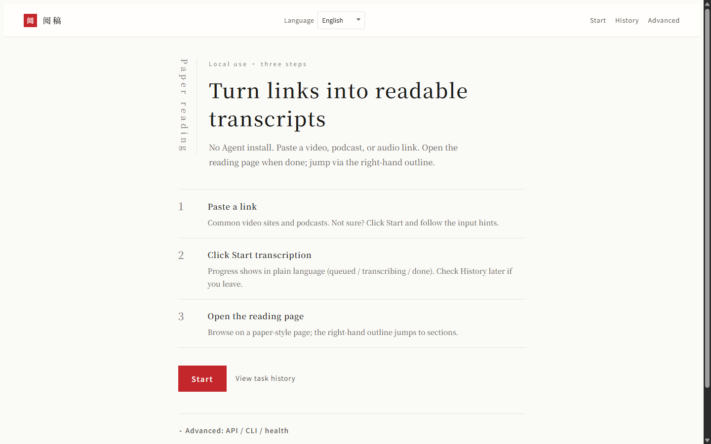

# 阅稿 Yuegao

[**中文**](README.md) | [English](README.en.md) | [日本語](README.ja.md) | [한국어](README.ko.md) | [Español](README.es.md) | [Français](README.fr.md) | [Português](README.pt.md) | [Deutsch](README.de.md) | [Русский](README.ru.md) | [العربية](README.ar.md)

把视频、播客或音频**链接**变成可阅读的文稿。在本机运行：粘贴链接，打开纸感阅读页。

界面只做链接转写，不提供本地音视频上传。密钥由你自己准备，仓库里没有生产环境的 API key。

许可：[PolyForm Noncommercial License 1.0.0](LICENSE)（仅限非商业用途）。请保留文件中的每一行 `Required Notice:`。

包名仍是 `video-transcript-api`，界面标题是「阅稿」。版本 **1.3.0**。



## 快速开始

```bash
git clone <你的阅稿仓库地址>
cd yuegao
# 需要 uv：https://docs.astral.sh/uv/
uv sync
cp config/config.example.jsonc config/config.jsonc
cp config/users.example.json config/users.json
# 编辑 config.jsonc：api.auth_token，以及 llm.api_key / llm.base_url（你自己的密钥）
uv run python main.py --check-config --config config/config.jsonc
uv run python main.py --start
```

浏览器打开首页（默认端口见配置里的 `api.port`，示例里常见 `8000`；部署脚本里也可能是 `8200`）。

冒烟：`uv run python scripts/ops/smoke_check.py --base http://127.0.0.1:8000`

## 你需要准备的

- 一份自己的 LLM 密钥（写在 `config/config.jsonc`，该文件已被 gitignore）
- 可选：TikHub 等下载器密钥，只在你要抓对应平台时填写
- 可选：本机 Whisper。没有 CapsWriter 时，用 `LOCAL_WHISPER_PYTHON` 或 `AMY_PYTHON` 指向已经装好 faster-whisper / openai-whisper 的解释器。不要把别人机器上的绝对路径写进仓库。

`capswriter-asr` 与 `llm-compat` 从公开 Git 仓库安装，见 `pyproject.toml` 的 `[tool.uv.sources]`。

## 界面语言

首页、提交页、历史和阅读页可以切换：zh-CN、en、ja、ko、es、fr、pt、de、ru、ar。

静态页用 `?lang=`，阅读页用 `/view/...&lang=`。默认语言是配置项 `language`。

## 安全

见 [SECURITY.md](SECURITY.md)。`/view/{token}` 是公开只读链接：拿到地址就能读那一篇。局域网部署不要裸露到公网。不要提交 `config/config.jsonc`、`config/users.json`、`.env` 或 `data/`。

## 许可与上游

本仓库是面向本地阅读的分支，视觉与文案是阅稿自己的纸感界面。不要把提交推回 `zlxlabs/VideoTranscriptAPI`。请使用你自己的公开仓库地址。
